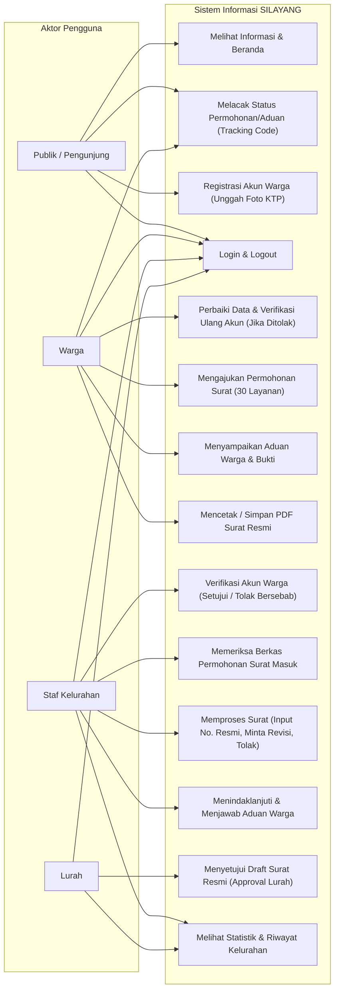
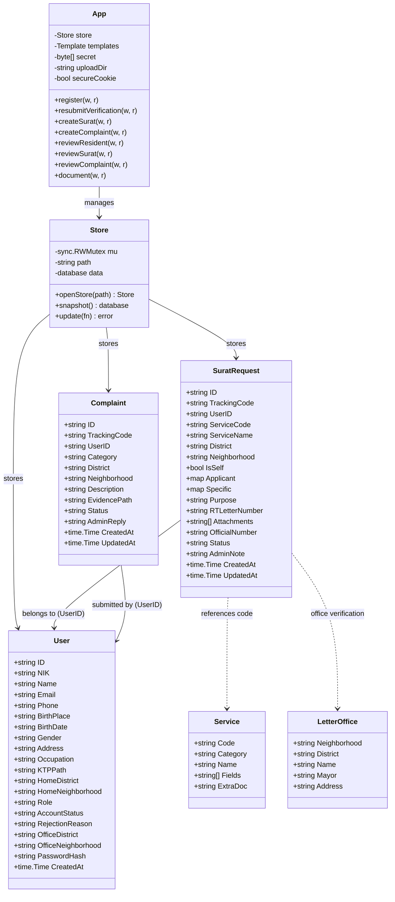
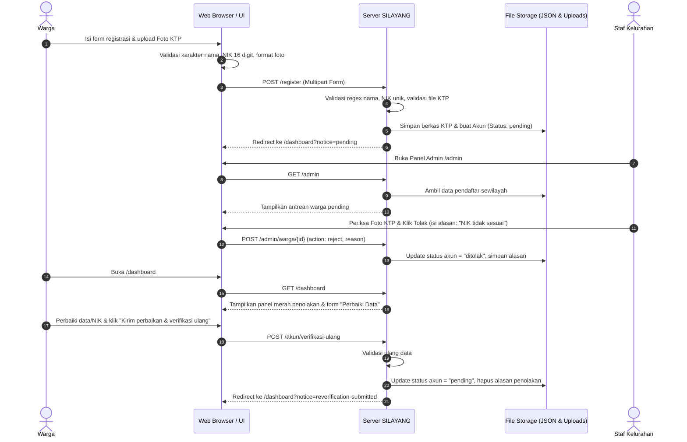
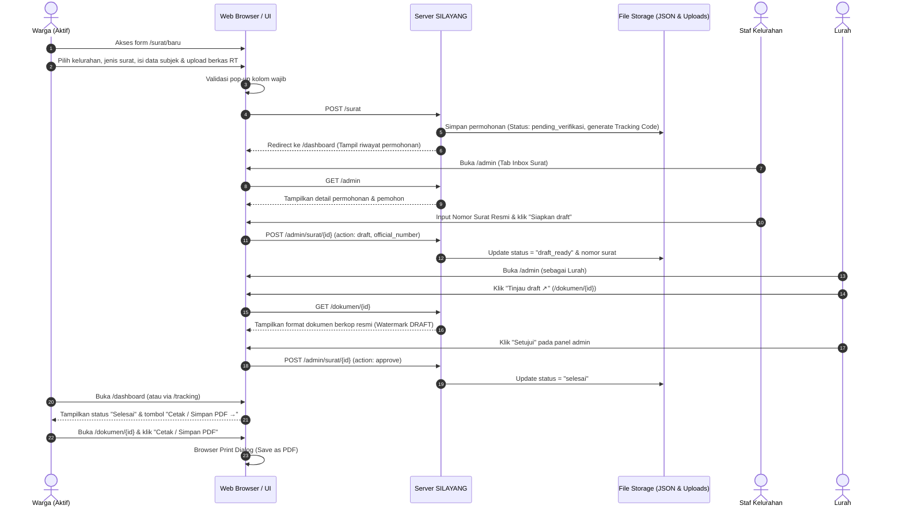
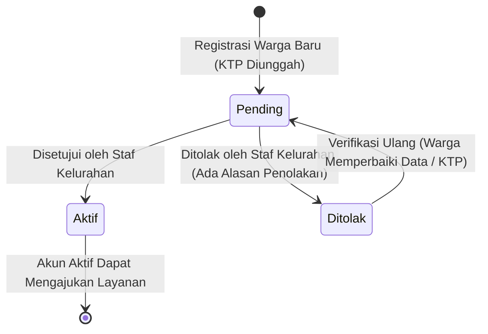
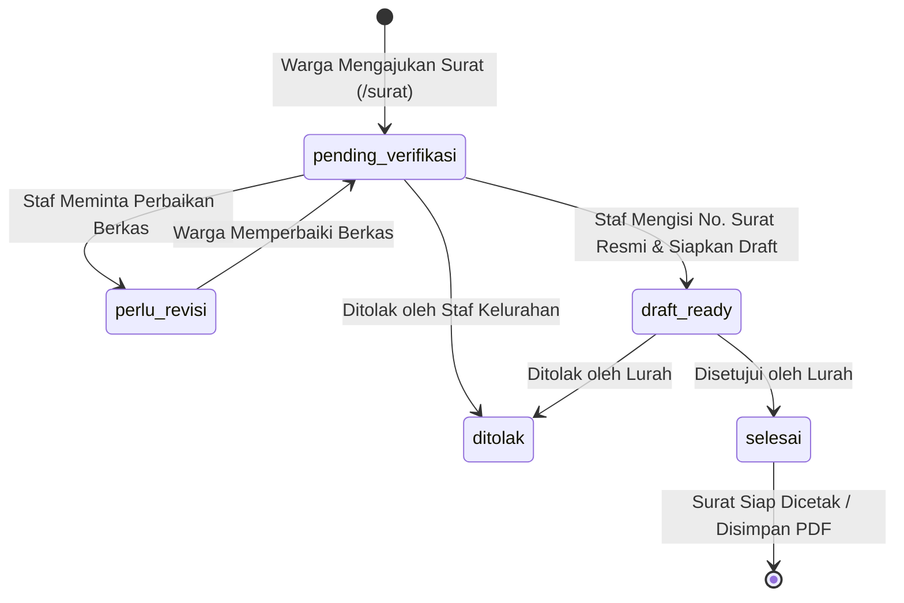
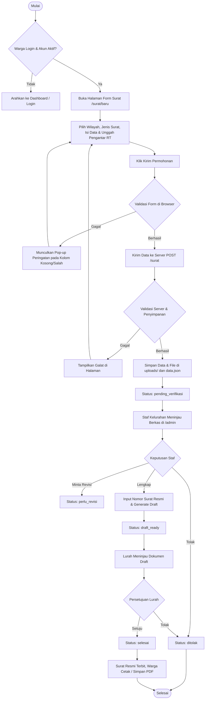

# SILAYANG

SILAYANG adalah portal layanan administrasi warga dan kelurahan berbasis Go. Warga dapat mengajukan surat, menyampaikan aduan, dan melacak permohonan. Staf kelurahan dan lurah mengelola layanan sesuai wilayah akun mereka.

## Mulai cepat

### Persyaratan

- Go **1.22 atau lebih baru**.
- PowerShell di Windows, Terminal di macOS/Linux, atau terminal bawaan VS Code.
- Tidak perlu memasang database atau paket tambahan.

Periksa Go:

```powershell
go version
```

### Jalankan aplikasi

1. Buka folder proyek di VS Code.
2. Buka terminal (**Terminal → New Terminal**). Pastikan terminal berada di folder yang berisi `go.mod`.
3. Jalankan:

   ```powershell
   go run .
   ```

4. Tunggu sampai terminal menampilkan alamat aplikasi, lalu buka **http://localhost:8080** di browser.
5. Untuk menghentikan aplikasi, kembali ke terminal dan tekan **Ctrl+C**.

Jalankan `go run .` dari folder proyek, bukan dengan membuka `main.go` langsung. Aplikasi membuat folder data dan unggahan jika belum tersedia.

### Jika port 8080 sedang digunakan

Pilih port lain sebelum menjalankan aplikasi:

```powershell
$env:SILAYANG_ADDR = ":8081"
go run .
```

Lalu buka **http://localhost:8081**.

### Buat file aplikasi (opsional)

Untuk mengompilasi aplikasi menjadi file `.exe`:

```powershell
go build -o silayang.exe .
.\silayang.exe
```

## Masuk dan mencoba aplikasi

Kata sandi awal akun demo adalah **`silayang123`**.

| Peran | Email demo | Catatan |
| --- | --- | --- |
| Warga | `warga@silayang.local` | Akun demo aktif |
| Staf | `staf@silayang.local` | Akun lama, dibatasi ke Kelurahan Talise |
| Lurah | `lurah@silayang.local` | Akun lama, dibatasi ke Kelurahan Talise |

Setiap satu dari **32 kelurahan** juga mendapat akun staf dan lurah. Format emailnya:

```text
staf.<kecamatan>-<kelurahan>@silayang.local
lurah.<kecamatan>-<kelurahan>@silayang.local
```

Contoh akun Tondo:

```text
staf.mantikulore-tondo@silayang.local
lurah.mantikulore-tondo@silayang.local
```

Semua akun wilayah menggunakan kata sandi awal yang sama, `silayang123`. Akun wilayah dibuat otomatis saat aplikasi dijalankan. Gunakan akun sesuai kelurahan yang ingin diuji.

### Alur singkat

1. **Warga:** masuk dengan akun demo atau daftar akun baru. Saat mendaftar, pilih kecamatan dan kelurahan domisili.
2. **Verifikasi:** akun baru menunggu persetujuan staf dari kelurahan domisili. Warga dapat mengajukan layanan setelah akun aktif.
3. **Surat:** warga memilih wilayah dan jenis surat, mengisi kebutuhan, lalu mengirim permohonan. Staf memeriksa dan menyiapkan draft; lurah menyetujuinya. Setelah status surat **Selesai**, warga dapat memilih **Cetak / Simpan PDF** di riwayat surat, lalu memilih **Simpan sebagai PDF** pada dialog cetak browser.
4. **Aduan:** warga mengirim aduan, lalu memantau tindak lanjutnya melalui dashboard.
5. **Lacak:** gunakan kode tracking yang diberikan setelah permohonan atau aduan dikirim.

Staf hanya dapat melihat pendaftar, foto KTP, dan permohonan surat untuk kelurahan akunnya. Lurah hanya dapat menyetujui draft surat dari kelurahannya. Data warga lama hanya dipetakan otomatis jika alamatnya menyebut nama kelurahan secara jelas.

## Data dan penyimpanan

Aplikasi **tidak memakai database SQL**. Data akun, surat, dan aduan disimpan dalam file JSON:

```text
data/silayang.json
```

Berkas unggahan, seperti foto KTP dan lampiran, disimpan di:

```text
uploads/
```

Data tetap ada setelah aplikasi dihentikan. Jangan menghapus atau membagikan file data maupun unggahan jika berisi informasi pribadi.

## Fitur utama

- Pendaftaran dan verifikasi akun warga.
- 30 jenis layanan surat dan pratinjau draf A4.
- Pembuatan, pemeriksaan, dan persetujuan surat sesuai wilayah akun.
- Aduan warga dan pelacakan status.
- Kop surat dinamis dengan data kantor kelurahan.

QR dan NIP pada dokumen yang disetujui adalah **dummy untuk tampilan saja**. QR tidak dapat dipakai untuk verifikasi dan tanda tangan bukan TTE resmi. Kode tracking tetap digunakan untuk melacak status permohonan.

## Pengaturan opsional

Atur variabel berikut sebelum menjalankan `go run .`:

| Variabel | Nilai bawaan | Fungsi |
| --- | --- | --- |
| `SILAYANG_ADDR` | `:8080` | Alamat dan port web server |
| `SILAYANG_DATA` | `data/silayang.json` | Lokasi file data JSON |
| `SILAYANG_UPLOADS` | `uploads` | Lokasi penyimpanan unggahan |
| `SILAYANG_SECRET` | Kunci development bawaan | Kunci sesi login |
| `SILAYANG_COOKIE_SECURE` | `false` | Gunakan `true` jika aplikasi diakses melalui HTTPS |

Contoh mengatur lokasi data di PowerShell:

```powershell
$env:SILAYANG_DATA = "data\uji.json"
go run .
```

## Menjalankan tes

Dari folder proyek, jalankan:

```powershell
go test ./...
```

## Catatan keamanan

Aplikasi ini ditujukan untuk demonstrasi dan pengembangan lokal. Kata sandi bersama, kunci sesi bawaan, HTTP tanpa HTTPS, dan file JSON lokal **tidak cocok untuk deployment produksi**. Layanan nyata memerlukan autentikasi dan pengelolaan kata sandi yang aman, HTTPS, penyimpanan data produksi, backup, serta TTE resmi.


# Dokumentasi Diagram UML — SILAYANG (Sistem Layanan Kelurahan)

Dokumen ini memuat kumpulan diagram **Unified Modeling Language (UML)** untuk sistem **SILAYANG**, yang dirancang sesuai dengan implementasi arsitektur sistem informasi berbasis Go, arsitektur multi-wilayah (32 kelurahan se-Kota Palu), serta alur kerja layanan administrasi publik.

---

## 1. Use Case Diagram

Diagram ini mendefinisikan fungsionalitas sistem dari sudut pandang para aktor: **Publik / Pengunjung**, **Warga**, **Staf Kelurahan**, dan **Lurah**.



---

## 2. Class Diagram

Class diagram ini memetakan struktur entitas data, model relasi, tipe penyimpanan file JSON (`Store`), dan controller aplikasi (`App`).



---

## 3. Sequence Diagram

### A. Alur Registrasi, Penolakan, dan Verifikasi Ulang Akun Warga
Diagram ini menggambarkan siklus validasi KTP, penolakan oleh staf, dan mekanisme perbaikan akun.



---

### B. Alur Pengajuan Surat sampai Disetujui dan Dicetak
Diagram ini menggambarkan proses bisnis pengajuan surat, pemeriksaan oleh staf, persetujuan lurah, dan pencetakan dokumen PDF.



---

## 4. State Machine Diagram

### A. Status Akun Warga (`AccountStatus`)


### B. Status Permohonan Surat (`SuratRequest.Status`)


---

## 5. Activity Diagram
 
### Alur Proses Pengajuan Layanan Surat

