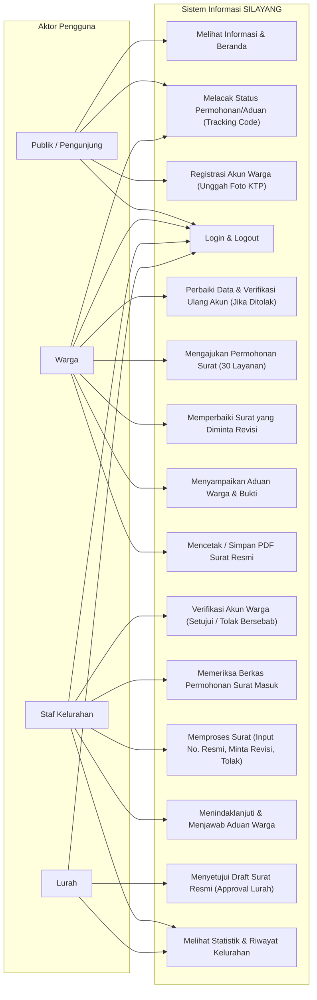
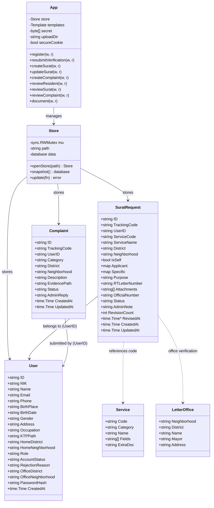
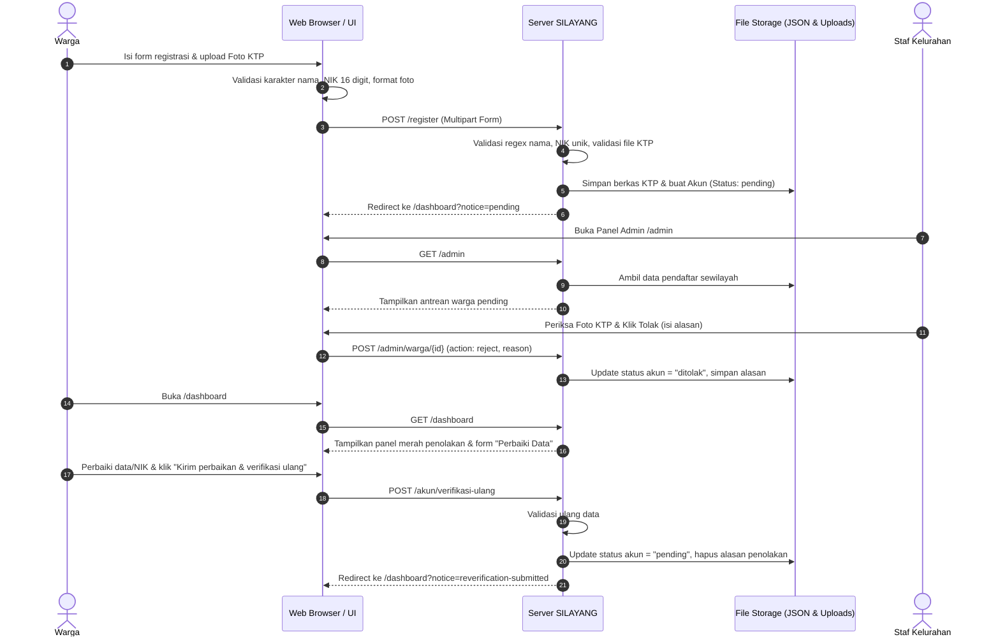
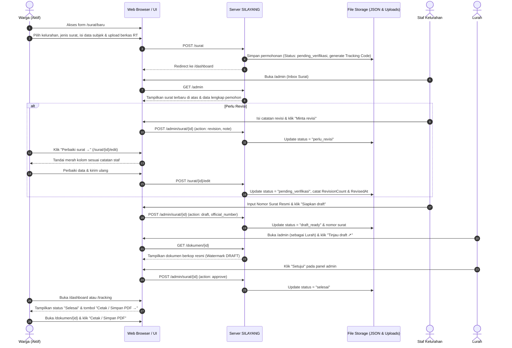
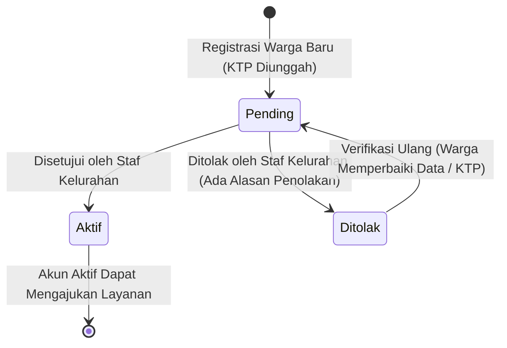
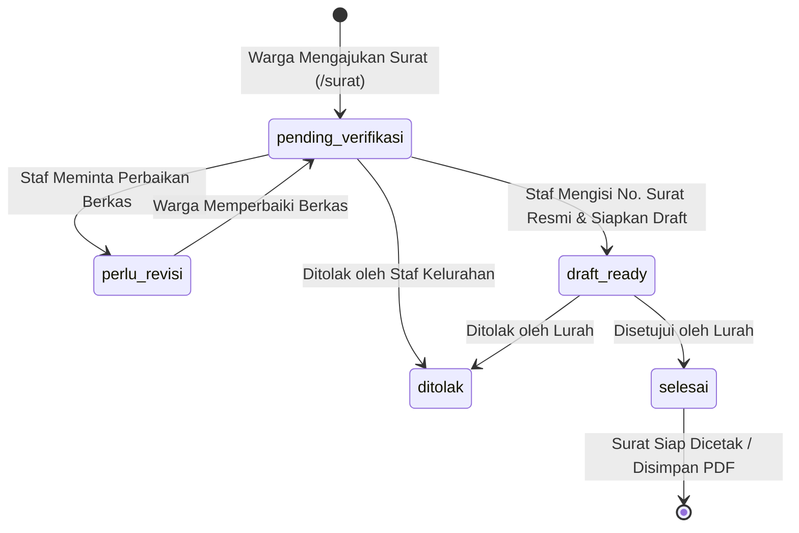
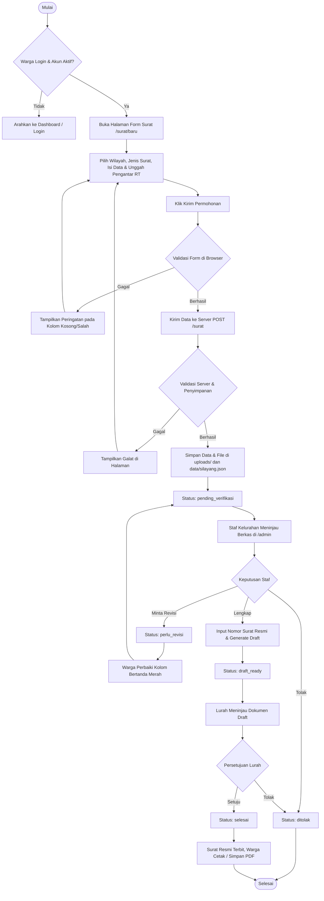

# SILAYANG — Sistem Layanan Kelurahan

**SILAYANG** adalah aplikasi web layanan administrasi kelurahan berbasis **Go** yang dirancang untuk memudahkan warga dalam mengajukan surat keterangan, menyampaikan aduan, serta memantau status permohonan secara daring. Di sisi internal, aplikasi mendukung alur kerja **Staf Kelurahan** dan **Lurah** sesuai wilayah masing-masing (32 kelurahan se-Kota Palu).

---

## Anggota Kelompok 11

| No | Nama | NIM |
| :---: | --- | --- |
| 1 | Amisha | `F5512510003` |
| 2 | Muh. Aqsha Syahrir | `F5512510033` |
| 3 | Moh. Akbar Nusantara | `F5512520037` |

---

## Daftar Isi

- [Fitur Utama](#fitur-utama)
- [Teknologi & Struktur Proyek](#teknologi--struktur-proyek)
- [Cara Menjalankan Aplikasi](#cara-menjalankan-aplikasi)
- [Akun Demo & Pengujian](#akun-demo--pengujian)
- [Alur Kerja Sistem](#alur-kerja-sistem)
- [Data, Penyimpanan & Pengaturan](#data-penyimpanan--pengaturan)
- [Menjalankan Unit Test](#menjalankan-unit-test)
- [Dokumentasi Diagram UML](#dokumentasi-diagram-uml)
- [Catatan Keamanan](#catatan-keamanan)

---

## Fitur Utama

- **Registrasi & Verifikasi Akun Warga**: Pendaftaran warga dilengkapi unggah foto KTP, validasi format input, serta alur penolakan bersebab dan verifikasi ulang jika data ditolak staf.
- **30 Jenis Layanan Surat**: Mencakup pengajuan untuk diri sendiri maupun orang lain/anggota keluarga, termasuk form terstruktur (seperti *Surat Keterangan Penghasilan* dengan data orang tua, data anak, dan rincian penghasilan).
- **Alur Revisi Surat Dua Arah**:
  - Staf dapat meminta revisi beserta catatan perbaikan.
  - Warga mendapat tombol **Perbaiki surat**, dengan **penanda warna merah otomatis** pada kolom yang perlu diperbaiki (berubah hijau setelah diedit).
  - Panel admin menampilkan status jelas (**Belum direvisi warga** / **Sudah direvisi warga**) serta rincian lengkap data pemohon dan surat terbaru di urutan paling atas.
- **Persetujuan Lurah & Cetak PDF**: Staf menyiapkan draf dengan nomor surat resmi, lalu lurah meninjau draf A4 berkop dinamis kelurahan dan menyetujui dokumen hingga siap dicetak/disimpan PDF oleh warga.
- **Aduan & Pelacakan Publik**: Warga dapat mengirim aduan beserta bukti, sementara status surat dan aduan dapat dipantau lewat dashboard maupun halaman `/tracking` menggunakan kode pelacakan (`REQ-...` / `ADU-...`).

---

## Teknologi & Struktur Proyek

- **Backend**: Go (`net/http`, `html/template`, penyimpanan file JSON dengan `sync.RWMutex`)
- **Frontend**: HTML Templates, CSS responsif (desktop & mobile), Vanilla JavaScript

```text
si-layang/
├── main.go                 # Server HTTP, routing, logika bisnis, model & store JSON
├── main_test.go            # Unit test & integration test alur aplikasi
├── go.mod                  # Definisi modul Go
├── Dockerfile              # Konfigurasi container Docker
├── docker-compose.yml      # Orkestrasi container
├── static/
│   ├── app.css             # Stylesheet utama & tampilan responsif
│   └── app.js              # Interaktivitas form, validasi & highlight revisi
├── templates/
│   ├── layout.html         # Kerangka layout utama
│   ├── home.html           # Halaman beranda
│   ├── auth.html           # Halaman masuk & daftar akun
│   ├── dashboard.html      # Dashboard warga / ringkasan petugas
│   ├── surat_form.html     # Form pengajuan 30 layanan surat
│   ├── surat_edit.html     # Form perbaikan (revisi) surat warga
│   ├── complaint_form.html # Form pengajuan aduan warga
│   ├── tracking.html       # Halaman lacak status permohonan/aduan
│   ├── admin.html          # Panel administrasi staf & lurah
│   └── document.html       # Pratinjau & cetak dokumen surat resmi A4
├── data/                   # Penyimpanan data JSON (dibuat otomatis)
└── uploads/                # Berkas unggahan KTP & lampiran (dibuat otomatis)
```

---

## Cara Menjalankan Aplikasi

### Persyaratan

- **Go 1.22** atau lebih baru (tidak memerlukan database eksternal maupun paket pihak ketiga).
- PowerShell di Windows, Terminal di macOS/Linux, atau terminal bawaan VS Code.

Periksa versi Go:

```powershell
go version
```

### Menjalankan Secara Lokal

1. Buka folder proyek dan pastikan terminal berada di direktori yang berisi `go.mod`.
2. Jalankan perintah berikut:

   ```powershell
   go run .
   ```

3. Buka **http://localhost:8080** di browser.
4. Tekan **Ctrl+C** di terminal untuk menghentikan server.

### Mengganti Port (Jika Port 8080 Terpakai)

```powershell
$env:SILAYANG_ADDR = ":8081"
go run .
```

Lalu akses **http://localhost:8081**.

### Build ke Binary (Opsional)

```powershell
go build -o silayang.exe .
.\silayang.exe
```

---

## Akun Demo & Pengujian

Semua akun bawaan menggunakan kata sandi awal: **`silayang123`**.

| Peran | Email | Keterangan |
| --- | --- | --- |
| Warga | `warga@silayang.local` | Akun demo warga aktif *(dibuat saat database awal masih kosong)* |
| Staf | `staf@silayang.local` | Akun demo staf (Kelurahan Talise) |
| Lurah | `lurah@silayang.local` | Akun demo lurah (Kelurahan Talise) |

Setiap kelurahan dari **32 kelurahan** di Kota Palu juga memiliki akun staf dan lurah yang dibuat otomatis dengan format:

```text
staf.<kecamatan>-<kelurahan>@silayang.local
lurah.<kecamatan>-<kelurahan>@silayang.local
```

Contoh untuk Kelurahan **Talise** (Kec. Mantikulore) dan **Tatura Utara** (Kec. Palu Selatan):

```text
staf.mantikulore-talise@silayang.local
lurah.mantikulore-talise@silayang.local

staf.palu-selatan-tatura-utara@silayang.local
lurah.palu-selatan-tatura-utara@silayang.local
```

---

## Alur Kerja Sistem

1. **Pendaftaran & Verifikasi Warga**: Warga mendaftar di `/register` sambil memilih kecamatan/kelurahan domisili dan mengunggah foto KTP. Staf kelurahan terkait meninjau pendaftar di `/admin` lalu menyetujui atau menolak (dengan alasan agar warga bisa memperbaiki data).
2. **Pengajuan & Pemeriksaan Surat**: Warga aktif mengajukan surat di `/surat/baru`. Staf memeriksa data lengkap pemohon di `/admin`, lalu memilih **Siapkan draft** (mengisi nomor surat resmi), **Minta revisi** (warga memperbaiki kolom yang ditandai merah), atau **Tolak**.
3. **Persetujuan Lurah & Cetak PDF**: Lurah meninjau draf surat di `/admin` → **Tinjau draft ↗**, lalu klik **Setujui**. Setelah status menjadi **Selesai**, warga dapat membuka dokumen dan menyimpannya sebagai PDF lewat dialog cetak browser.
4. **Aduan & Pelacakan**: Warga mengirim aduan di `/aduan/baru` dan petugas menindaklanjutinya di `/admin`. Status permohonan surat dan aduan dapat dicek kapan saja melalui `/tracking`.

---

## Data, Penyimpanan & Pengaturan

Aplikasi menyimpan seluruh data akun, permohonan surat, dan aduan dalam format JSON tanpa database SQL:

- Data aplikasi: `data/silayang.json`
- Berkas unggahan (foto KTP, pengantar RT, bukti aduan): `uploads/`

Variabel lingkungan opsional yang dapat diatur sebelum `go run .`:

| Variabel | Nilai Bawaan | Fungsi |
| --- | --- | --- |
| `SILAYANG_ADDR` | `:8080` | Alamat dan port web server |
| `SILAYANG_DATA` | `data/silayang.json` | Lokasi file data JSON |
| `SILAYANG_UPLOADS` | `uploads` | Direktori penyimpanan berkas unggahan |
| `SILAYANG_SECRET` | Kunci development bawaan | Kunci penandatanganan sesi cookie |
| `SILAYANG_COOKIE_SECURE` | `false` | Set `true` jika dijalankan di balik HTTPS |

---

## Menjalankan Unit Test

Dari direktori utama proyek, jalankan:

```powershell
go test -count=1 ./...
```

---

## Dokumentasi Diagram UML

Bagian ini memuat dokumentasi rancangan sistem **SILAYANG** menggunakan **Unified Modeling Language (UML)**.

### 1. Use Case Diagram



### 2. Class Diagram



### 3. Sequence Diagram

#### A. Registrasi, Penolakan, dan Verifikasi Ulang Akun Warga



#### B. Pengajuan Surat, Revisi, sampai Disetujui dan Dicetak



### 4. State Machine Diagram

#### A. Status Akun Warga (`AccountStatus`)



#### B. Status Permohonan Surat (`SuratRequest.Status`)



### 5. Activity Diagram — Alur Pengajuan Layanan Surat



---

## Catatan Keamanan

Aplikasi ini ditujukan untuk simulasi, pembelajaran, dan demonstrasi tugas perkuliahan. QR code, NIP, dan tanda tangan pada dokumen yang disetujui bersifat **simulasi/dummy** (bukan TTE resmi). Untuk penggunaan produksi nyata diperlukan autentikasi yang lebih ketat, HTTPS, basis data produksi, serta integrasi TTE resmi.
