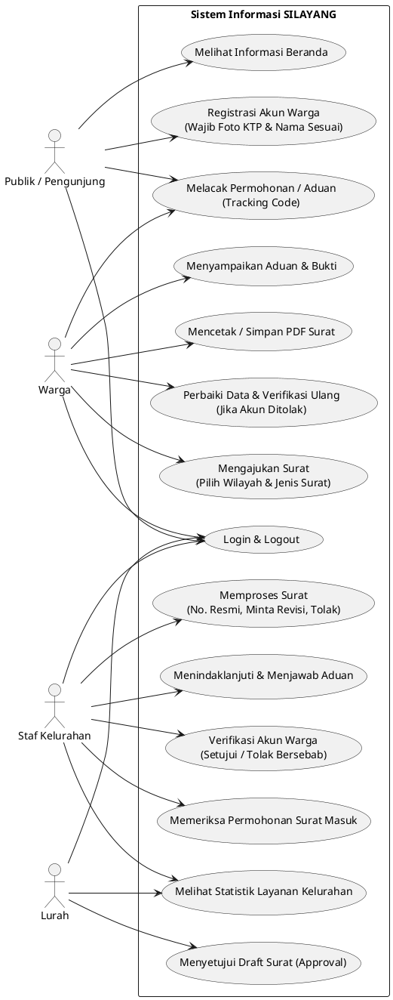
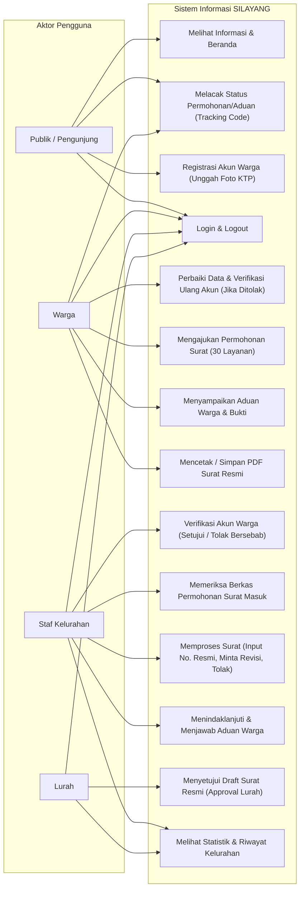
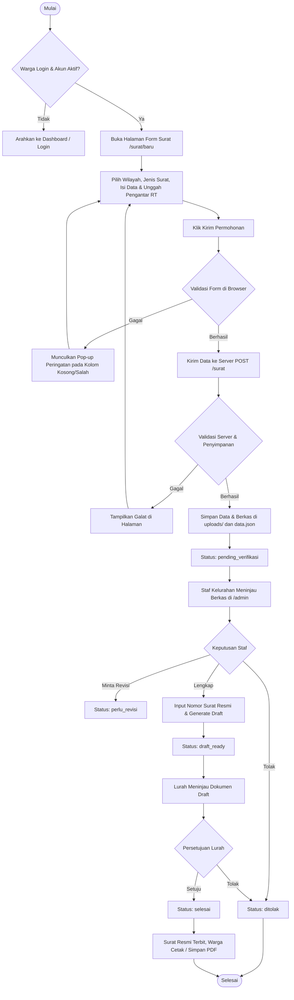
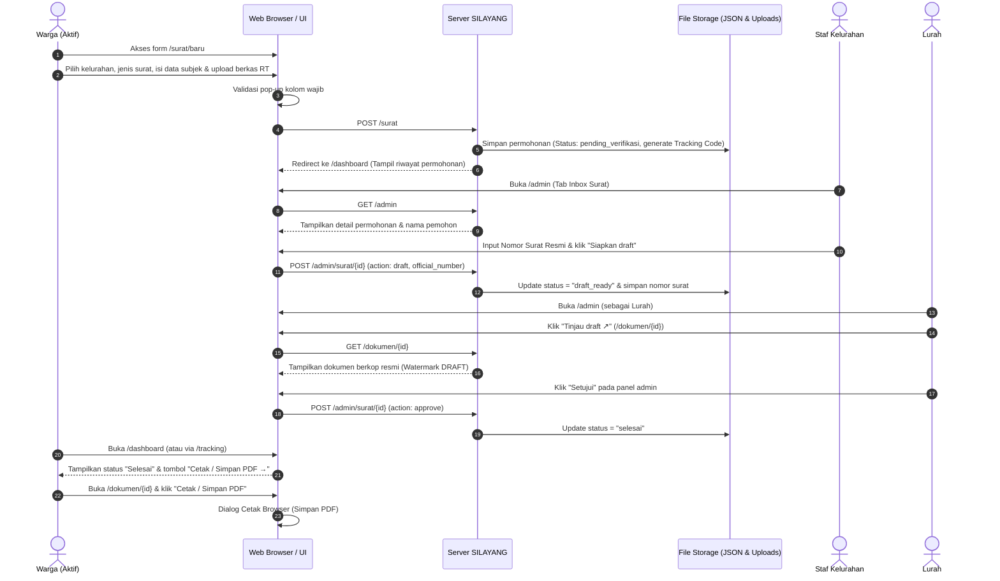
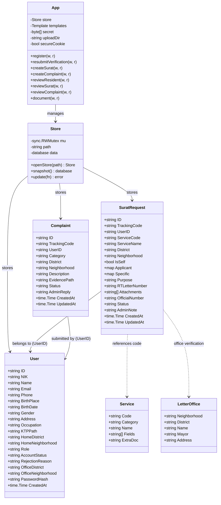
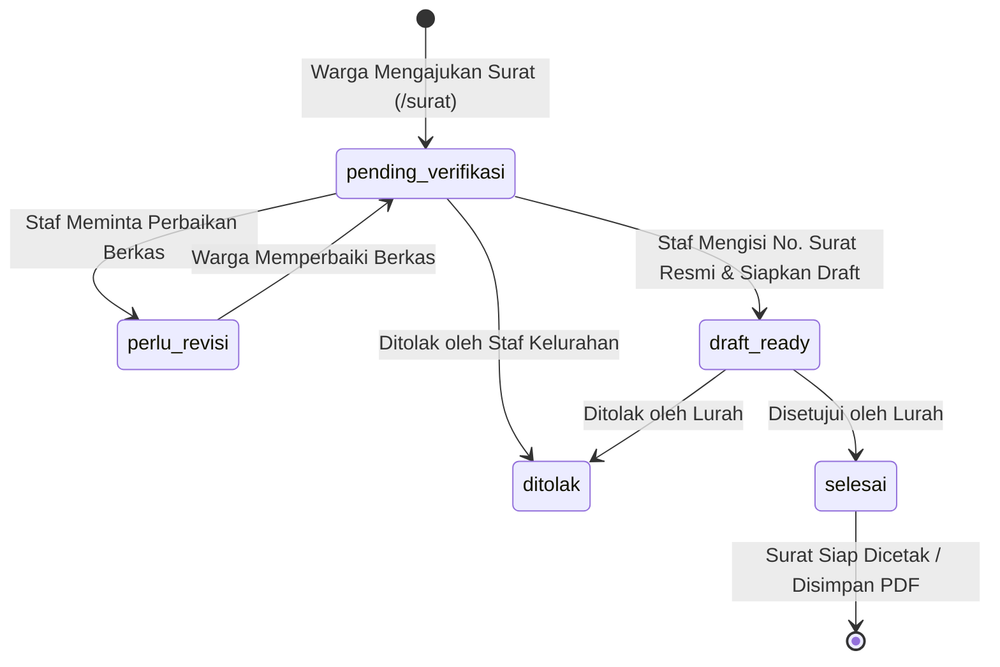

# Panduan & Kode Diagram UML untuk Draw.io (diagrams.net)

Dokumen ini berisi kode yang siap Anda salin (**copy-paste**) ke dalam **draw.io** (atau [app.diagrams.net](https://app.diagrams.net)).

---

## Cara Memasukkan Kode ke Draw.io

1. Buka [draw.io](https://app.diagrams.net/).
2. Pada menu bar bagian atas, klik tombol **`+`** (atau menu **Arrange / Atur** $\rightarrow$ **Insert / Sisipkan** $\rightarrow$ **Advanced / Lanjutan**).
3. Pilih **Mermaid** (atau **PlantUML** sesuai kode yang dipilih).
4. Hapus teks contoh, lalu **tempel (paste)** kode diagram di bawah ini.
5. Klik tombol **Insert**. Gambar diagram UML akan langsung terbentuk menjadi objek/shape yang bisa Anda geser, ubah warna, dan atur posisinya.

---

## 1. Use Case Diagram

### Opsi A: Format PlantUML (Rekomendasi untuk Use Case karena menghasilkan ikon orang/stickman standar UML)
> *Di draw.io: Klik **`+` $\rightarrow$ Advanced $\rightarrow$ PlantUML***

### Opsi B: Format Mermaid
> *Di draw.io: Klik **`+` $\rightarrow$ Advanced $\rightarrow$ Mermaid***

---

## 2. Activity Diagram (Alur Pengajuan Surat)

> *Di draw.io: Klik **`+` $\rightarrow$ Advanced $\rightarrow$ Mermaid***

---

## 3. Sequence Diagram (Pengajuan & Penerbitan Surat)

> *Di draw.io: Klik **`+` $\rightarrow$ Advanced $\rightarrow$ Mermaid***

---

## 4. Class Diagram

> *Di draw.io: Klik **`+` $\rightarrow$ Advanced $\rightarrow$ Mermaid***

---

## 5. State Machine Diagram (Status Surat & Akun)

> *Di draw.io: Klik **`+` $\rightarrow$ Advanced $\rightarrow$ Mermaid***

